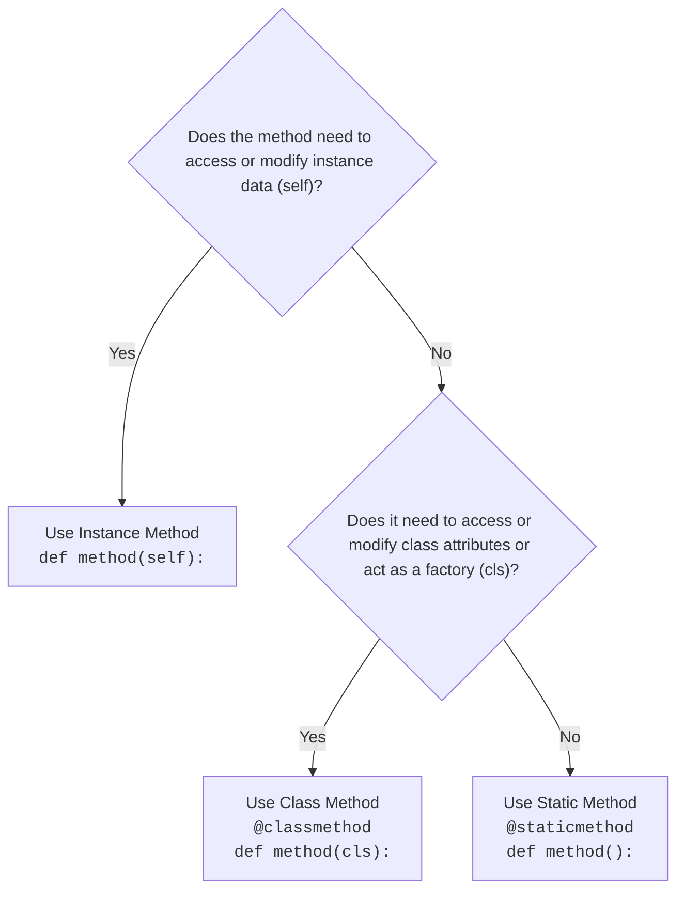

# OOP: Static Attributes, Class Methods, and Static Methods in Python

A complete guide and reference on **Class Attributes (Static Attributes)**, **Instance Attributes**, **`@classmethod`**, and **`@staticmethod`** in Python.

---

## 1. Quick Comparison Matrix

| Feature | Instance Method | Class Method (`@classmethod`) | Static Method (`@staticmethod`) |
| :--- | :--- | :--- | :--- |
| **Decorator** | None | `@classmethod` | `@staticmethod` |
| **First Parameter** | `self` (points to the instance) | `cls` (points to the class) | None (no automatic parameter) |
| **Access to Instance State (`self`)** | **Yes** | No | No |
| **Access to Class State (`cls`)** | **Yes** (via `self.__class__`) | **Yes** | No (unless explicitly referencing class name) |
| **How to Call** | `instance.method()` | `ClassName.method()` or `instance.method()` | `ClassName.method()` or `instance.method()` |
| **Primary Use Case** | Operations tied to a specific object's data. | Factory constructors, inspecting/modifying class attributes. | Isolated utility/helper functions related to the class. |

---

## 2. Static Attribute (Class Attribute) vs Instance Attribute

### What is a Static (Class) Attribute?
- A **Class Attribute** is defined directly inside the class body, outside any methods.
- It is **shared by all instances** of the class. Only one copy exists in memory for the whole class.
- Accessed using `ClassName.attribute_name` (recommended) or `instance.attribute_name`.

### What is an Instance Attribute?
- Defined inside methods (typically `__init__`) using `self.attribute_name`.
- Each instance has its own unique copy.

### Code Example:

```python
class Shopping:
    # --- Class / Static Attributes (Shared across all objects) ---
    mall_name = "Jamuna Future Park"
    origin_country = "Bangladesh"

    def __init__(self, customer_name: str, balance: float):
        # --- Instance Attributes (Unique per object) ---
        self.customer_name = customer_name
        self.balance = balance


# Creating instances
customer1 = Shopping("Rahim", 5000)
customer2 = Shopping("Karim", 10000)

# 1. Accessing class attributes
print(Shopping.mall_name)       # Jamuna Future Park
print(customer1.mall_name)      # Jamuna Future Park (falls back to class attribute)
print(customer2.mall_name)      # Jamuna Future Park

# 2. Modifying via Class Name changes it for all instances
Shopping.mall_name = "Bashundhara City"
print(customer1.mall_name)      # Bashundhara City
print(customer2.mall_name)      # Bashundhara City

# 3. Instance attributes remain independent
print(customer1.customer_name)  # Rahim
print(customer2.customer_name)  # Karim
```

> [!WARNING]
> **Beware of Mutable Class Attributes (e.g., `cart = []`)**:
> If a class attribute is a mutable object like a `list` or `dict`, modifying it (e.g., `cart.append(...)`) will mutate the shared list for **every** instance! Keep per-object collections inside `__init__` as instance attributes (`self.cart = []`).

---

## 3. Class Method (`@classmethod`)

### What is a Class Method?
- A method decorated with `@classmethod`.
- Receives the **class itself** as its first argument by convention: `cls`.
- It can read and modify the **class state** (class attributes), but it has **no access** to individual instance attributes (`self`).

### Key Use Cases:
1. **Modifying Class State**: Updating shared class-level attributes.
2. **Factory Methods / Alternative Constructors**: Creating class instances from different formats (e.g., strings, JSON, tuples).

### Code Example:

```python
class Shopping:
    discount_percentage = 10  # Class attribute

    def __init__(self, item: str, price: float):
        self.item = item
        self.price = price

    # --- Class Method: Modifying Class Attribute ---
    @classmethod
    def set_discount(cls, new_discount: float):
        """Modifies shared class state for all future/existing instances."""
        cls.discount_percentage = new_discount

    # --- Class Method: Factory Constructor ---
    @classmethod
    def from_string(cls, item_str: str):
        """Creates an instance from a string formatted as 'Item-Price'."""
        item, price = item_str.split("-")
        return cls(item.strip(), float(price))


# 1. Changing class-level state
Shopping.set_discount(15)
print(f"Global discount: {Shopping.discount_percentage}%")  # 15%

# 2. Using as a factory constructor
product = Shopping.from_string("Panjabi-2500")
print(product.item)   # Panjabi
print(product.price)  # 2500.0
```

---

## 4. Static Method (`@staticmethod`)

### What is a Static Method?
- A method decorated with `@staticmethod`.
- Does **not** receive an implicit first argument (neither `self` nor `cls`).
- It behaves just like a standard function, but resides within the class's namespace for logical grouping.
- It cannot access or alter instance state or class state directly.

### Key Use Cases:
- **Helper / Utility functions**: Operations that relate logically to the class concept, but do not depend on object or class state (e.g., math calculations, validations, conversions).

### Code Example:

```python
class Shopping:
    @staticmethod
    def calculate_vat(amount: float, vat_rate: float = 7.5) -> float:
        """Utility calculation: doesn't need 'self' or 'cls'."""
        return (amount * vat_rate) / 100

    @staticmethod
    def is_valid_phone(phone: str) -> bool:
        """Validation helper."""
        return phone.startswith("+880") and len(phone) == 14


# Calling directly via the Class Name
vat = Shopping.calculate_vat(1000)
print(f"VAT: {vat}")  # VAT: 75.0

is_valid = Shopping.is_valid_phone("+8801712345678")
print(f"Valid Phone: {is_valid}")  # Valid Phone: True
```

---

## 5. Comprehensive Example: Bringing Everything Together

Here is a complete scenario demonstrating how all three method types and static attributes collaborate:

```python
class Store:
    # 1. Class / Static Attribute
    total_sales_count = 0
    store_branch = "Mirpur"

    def __init__(self, customer_name: str):
        # 2. Instance Attribute
        self.customer_name = customer_name
        self.purchased_items = []

    # 3. Instance Method: needs 'self' to access customer's own cart & balance
    def buy_item(self, item_name: str, price: float, amount_given: float):
        change = self.subtract(amount_given, price)  # Calls static helper
        self.purchased_items.append(item_name)
        Store.total_sales_count += 1                 # Updates class state
        print(f"[{self.customer_name}] bought {item_name}. Change returned: Tk {change}")

    # 4. Class Method: needs 'cls' to inspect/update class state
    @classmethod
    def change_branch(cls, new_branch: str):
        cls.store_branch = new_branch
        print(f"Store branch changed to: {cls.store_branch}")

    @classmethod
    def get_sales_summary(cls):
        return f"Branch: {cls.store_branch} | Total sales made: {cls.total_sales_count}"

    # 5. Static Method: pure utility, independent of self or cls
    @staticmethod
    def subtract(a: float, b: float) -> float:
        return a - b

    @staticmethod
    def multiply(a: float, b: float) -> float:
        return a * b


# ---------------- Driver Code ----------------

# Calling Static Methods directly
print("3 * 5 =", Store.multiply(3, 5))  # 15

# Creating Objects
customer_a = Store("Shakib")
customer_b = Store("Tamim")

# Calling Instance Methods
customer_a.buy_item("Jersey", 1200, 1500)
customer_b.buy_item("Bat", 4500, 5000)

# Calling Class Methods
print(Store.get_sales_summary())
# Output: Branch: Mirpur | Total sales made: 2

Store.change_branch("Dhanmondi")
print(Store.get_sales_summary())
# Output: Branch: Dhanmondi | Total sales made: 2
```

---

## 6. How to Choose: Which One Should You Use?

Ask yourself these questions when designing a method:



### Summary Checklist:
1. **Class Attribute**: Defined in class body; shared by all instances.
2. **`@classmethod`**: Uses `cls`; works with class-level variables or serves as alternate constructors.
3. **`@staticmethod`**: Uses neither `self` nor `cls`; isolated utility or helper logic grouped under the class namespace.
