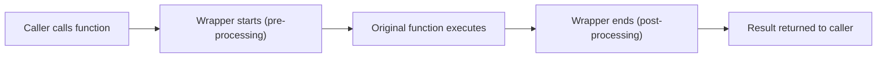

# Python: Inner Functions, Closures, and Wrapper Functions (Decorators)

A comprehensive guide and reference on **First-Class Functions**, **Inner (Nested) Functions**, **Closures**, and **Wrapper Functions (Decorators)** in Python.

---

## 1. Prerequisites: Functions are First-Class Objects

In Python, functions are **first-class citizens** (or first-class objects). This means functions can be:
1. Assigned to variables.
2. Passed as arguments to other functions.
3. Returned from other functions.
4. Stored in data structures (lists, dictionaries, etc.).

```python
def greet(name):
    return f"Hello, {name}!"

# 1. Assigning to a variable
say_hello = greet
print(say_hello("Alice"))  # Hello, Alice!

# 2. Passing as an argument to another function
def execute(func, value):
    return func(value)

print(execute(greet, "Bob"))  # Hello, Bob!
```

---

## 2. Inner Functions (Nested Functions)

### What is an Inner Function?
An **inner function** (or nested function) is simply a function defined inside the body of another function (the outer function).

```python
def outer_function():
    print("Executing outer_function")

    def inner_function():
        print("Executing inner_function")

    # Calling the inner function from inside the outer function
    inner_function()

outer_function()
# Output:
# Executing outer_function
# Executing inner_function
```

> [!NOTE]
> `inner_function` is locally scoped to `outer_function`. It **cannot** be called directly from outside (`inner_function()` in the global scope raises `NameError`).

---

### Returning an Inner Function

Because functions are first-class objects, an outer function can return its inner function **without calling it**:

```python
def double_decker():
    print("Starting the double decker")

    def inner_fun():
        print("Inside the inner function")
        return 3000

    return inner_fun  # Returns function object reference (NOT inner_fun())

# Step 1: Call outer function, which returns the inner function
my_func = double_decker()
# Output: Starting the double decker

# Step 2: Call the returned inner function
result = my_func()
# Output: Inside the inner function
print(result)
# Output: 3000

# Or call directly in one line:
# double_decker()()
```

---

### Closures & the `nonlocal` Keyword

When an inner function remembers and accesses variables from its enclosing (outer) scope even after the outer function has finished executing, it is called a **Closure**.

```python
def multiplier(factor):
    # 'factor' belongs to the outer scope
    def multiply_by(number):
        return number * factor  # Remembers 'factor'
    
    return multiply_by

times_five = multiplier(5)
times_ten = multiplier(10)

print(times_five(6))  # Output: 30
print(times_ten(6))   # Output: 60
```

#### Modifying Outer Variables using `nonlocal`:
By default, you can read outer variables. If you want to modify an outer variable inside an inner function, use the `nonlocal` keyword:

```python
def counter():
    count = 0

    def increment():
        nonlocal count  # Allows modification of enclosing variable
        count += 1
        return count

    return increment

my_counter = counter()
print(my_counter())  # 1
print(my_counter())  # 2
print(my_counter())  # 3
```

---

### Why Use Inner Functions?
1. **Encapsulation / Information Hiding**: Keeps helper functions private and hidden from the global namespace.
2. **Code Organization & DRY**: Groups repetitive sub-tasks neatly inside the relevant function.
3. **Building Closures & Decorators**: The foundational building block for wrapper functions.

---

## 3. Wrapper Functions and Decorators

### What is a Wrapper Function?
A **wrapper function** is an inner function that "wraps" around another function to **extend or modify its behavior without permanently altering its source code**.

A function that takes another function, wraps it, and returns the wrapper is called a **Decorator**.



---

### Step-by-Step Evolution: From Manual Wrapper to `@decorator`

#### 1. Manual Wrapping
```python
def my_decorator(func):
    def wrapper():
        print(">>> [Pre-logic] Before function execution")
        func()  # Execute original function
        print(">>> [Post-logic] After function execution")
    return wrapper

def coding():
    print("Coding in Python...")

# Manually wrapping the function
wrapped_coding = my_decorator(coding)
wrapped_coding()
# Output:
# >>> [Pre-logic] Before function execution
# Coding in Python...
# >>> [Post-logic] After function execution
```

#### 2. Using the `@` Syntactic Sugar
Python provides the `@` symbol as clean shorthand for `func = decorator(func)`:

```python
@my_decorator
def coding():
    print("Coding in Python...")

# Calling coding() automatically triggers the wrapper
coding()
```

---

## 4. Writing Production-Ready Wrappers

### A. Supporting Any Arguments (`*args`, `**kwargs`) & Return Values

A robust wrapper must:
1. Accept arbitrary positional (`*args`) and keyword (`**kwargs`) arguments.
2. Pass them to the original function.
3. Capture and return the original function's return value.

```python
def log_activity(func):
    def wrapper(*args, **kwargs):
        print(f"[LOG] Calling '{func.__name__}' with args={args}, kwargs={kwargs}")
        result = func(*args, **kwargs)  # Call target function
        print(f"[LOG] '{func.__name__}' returned {result}")
        return result  # Ensure return value is preserved
    return wrapper

@log_activity
def add(a, b):
    return a + b

@log_activity
def greet(name, title="Mr."):
    return f"Hello, {title} {name}"

total = add(10, 25)
# Output:
# [LOG] Calling 'add' with args=(10, 25), kwargs={}
# [LOG] 'add' returned 35

message = greet("Rahim", title="Dr.")
# Output:
# [LOG] Calling 'greet' with args=('Rahim',), kwargs={'title': 'Dr.'}
# [LOG] 'greet' returned Hello, Dr. Rahim
```

---

### B. Preserving Metadata with `functools.wraps`

When you wrap a function, its `__name__` and `__doc__` get replaced by the wrapper's name. Use `@functools.wraps` to preserve the original function identity:

```python
import functools

def my_decorator(func):
    @functools.wraps(func)  # Keeps original func name and docstring
    def wrapper(*args, **kwargs):
        return func(*args, **kwargs)
    return wrapper

@my_decorator
def calculate_area(radius):
    """Calculates circle area."""
    return 3.1416 * radius * radius

print(calculate_area.__name__)  # calculate_area (without @wraps, this would be 'wrapper')
print(calculate_area.__doc__)   # Calculates circle area.
```

---

## 5. Practical Real-World Examples

### Example 1: Execution Timer Decorator
Measure how long a function takes to execute.

```python
import time
import functools

def timer(func):
    @functools.wraps(func)
    def wrapper(*args, **kwargs):
        start_time = time.perf_counter()
        result = func(*args, **kwargs)
        end_time = time.perf_counter()
        elapsed = end_time - start_time
        print(f"⏱️ '{func.__name__}' took {elapsed:.6f} seconds to complete.")
        return result
    return wrapper

@timer
def compute_heavy_task(n):
    return sum(i * i for i in range(n))

compute_heavy_task(1_000_000)
# Output:
# ⏱️ 'compute_heavy_task' took 0.045123 seconds to complete.
```

---

### Example 2: Simple Authentication / Permission Checker
Validate whether a user is allowed to perform an action.

```python
import functools

CURRENT_USER = {"name": "Sabbir", "role": "user"}  # Change role to 'admin' to permit

def require_admin(func):
    @functools.wraps(func)
    def wrapper(*args, **kwargs):
        if CURRENT_USER.get("role") != "admin":
            print(f"⛔ Access Denied: User '{CURRENT_USER['name']}' is not an admin!")
            return None
        return func(*args, **kwargs)
    return wrapper

@require_admin
def delete_database():
    print("⚠️ Database successfully deleted!")

delete_database()
# Output:
# ⛔ Access Denied: User 'Sabbir' is not an admin!
```

---

## 6. Cheat Sheet & Key Rules

1. **Inner Function**:
   - Defined inside another function.
   - Hidden from the outside world (encapsulation).
2. **Closure**:
   - An inner function retaining access to variables from its outer enclosing scope even after the outer function finishes.
   - Use `nonlocal` if you need to modify an outer variable.
3. **Wrapper Function**:
   - An inner function wrapped around a target function to inject pre-execution or post-execution code.
4. **Standard Decorator Template**:
   ```python
   import functools

   def my_decorator(func):
       @functools.wraps(func)
       def wrapper(*args, **kwargs):
           # 1. Pre-execution logic
           result = func(*args, **kwargs)
           # 2. Post-execution logic
           return result
       return wrapper
   ```
